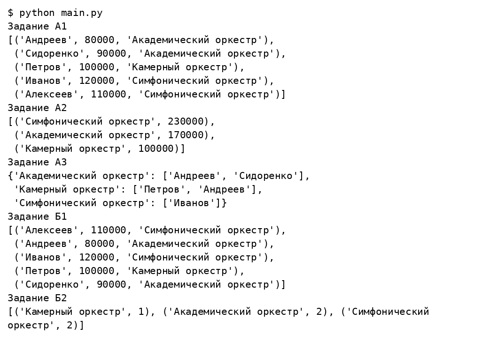
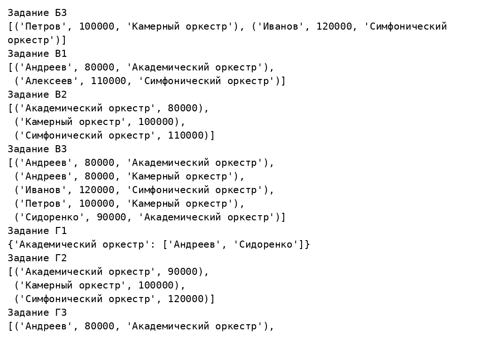
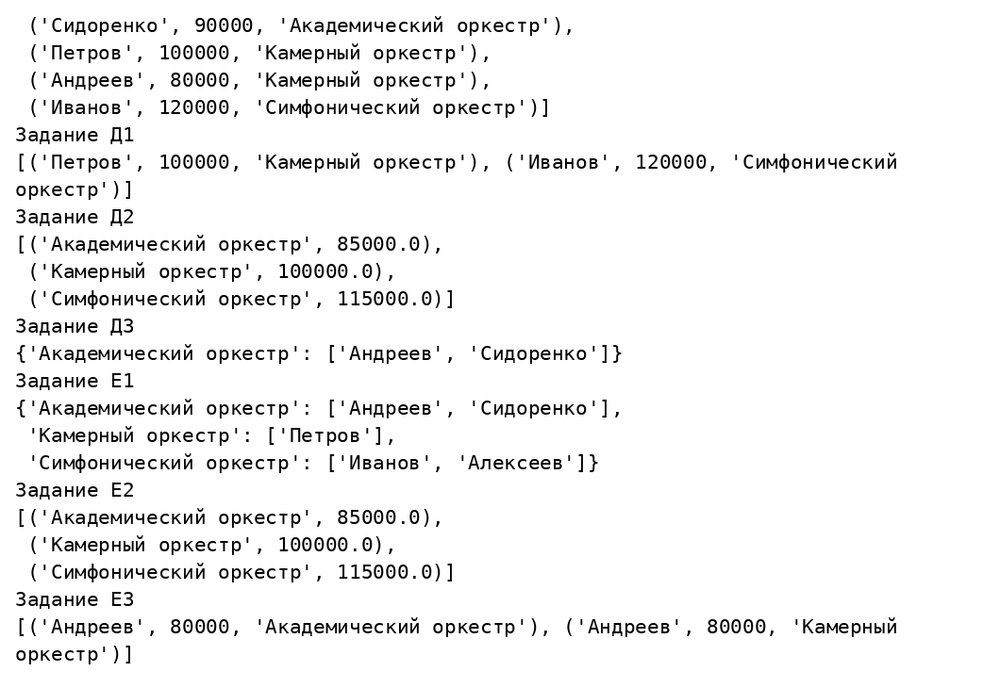

# Рубежный контроль 1

## Дирижёры и оркестры

Вариант 17

Студент ____________________

Группа ____________________

Преподаватель ____________________

Москва 2026

## Задание

Для варианта 17 создать классы Дирижёр и Оркестр и класс связи для отношения многие ко многим. Подготовить 3–5 тестовых записей и выполнить три запроса выбранного буквенного набора с использованием функциональных средств Python.

## Решение

Conductor содержит ID, фамилию, зарплату и orchestra_id; Orchestra — ID и название. ConductorOrchestra содержит два внешних ключа. В данных пять дирижёров, три оркестра и пять связей. Все внешние ключи ссылаются на существующие записи. Номер 17 определяет только классы; PDF не связывает его с наборами А–Е. Поэтому реализованы все шесть наборов. --queries А выбирает один набор, по умолчанию выполняются все.

### assessments/rk_01/data.py

```python
from models import Conductor, Orchestra, ConductorOrchestra


def sample_data():
    orchestras = [Orchestra(1, 'Академический оркестр'),
                  Orchestra(2, 'Камерный оркестр'),
                  Orchestra(3, 'Симфонический оркестр')]
    conductors = [Conductor(1, 'Андреев', 80000, 1),
                  Conductor(2, 'Петров', 100000, 2),
                  Conductor(3, 'Иванов', 120000, 3),
                  Conductor(4, 'Сидоренко', 90000, 1),
                  Conductor(5, 'Алексеев', 110000, 3)]
    links = [ConductorOrchestra(1, 1), ConductorOrchestra(1, 4),
             ConductorOrchestra(2, 2), ConductorOrchestra(2, 1),
             ConductorOrchestra(3, 3)]
    return conductors, orchestras, links
```

### assessments/rk_01/main.py

```python
import argparse
from pprint import pprint
from data import sample_data
from queries import run_queries


if __name__ == '__main__':
    parser = argparse.ArgumentParser(description='РК-1, вариант предметной области 17')
    parser.add_argument('--queries', choices=list('АБВГДЕ') + ['all'], default='all')
    args = parser.parse_args()
    letters = 'АБВГДЕ' if args.queries == 'all' else args.queries
    for letter in letters:
        for index, result in enumerate(run_queries(letter, *sample_data()), 1):
            print(f'Задание {letter}{index}')
            pprint(result, width=88, sort_dicts=False)
```

### assessments/rk_01/models.py

```python
from dataclasses import dataclass


@dataclass
class Conductor:
    id: int
    surname: str
    salary: int
    orchestra_id: int


@dataclass
class Orchestra:
    id: int
    name: str


@dataclass
class ConductorOrchestra:
    orchestra_id: int
    conductor_id: int
```

### assessments/rk_01/queries.py

```python
def one_to_many(conductors, orchestras):
    return [(c.surname, c.salary, o.name) for o in orchestras
            for c in conductors if c.orchestra_id == o.id]


def many_to_many(conductors, orchestras, links):
    return [(c.surname, c.salary, o.name) for link in links
            for o in orchestras for c in conductors
            if link.orchestra_id == o.id and link.conductor_id == c.id]


def salary_statistics(rows, orchestras, operation):
    result = []
    for orchestra in orchestras:
        salaries = [salary for _, salary, name in rows if name == orchestra.name]
        if salaries or operation == 'count':
            operations = {'sum': sum, 'min': min, 'max': max, 'count': len,
                          'average': lambda values: sum(values) / len(values),
                          'rounded_average': lambda values: round(sum(values) / len(values), 2)}
            result.append((orchestra.name, operations[operation](salaries)))
    return sorted(result, key=lambda row: row[1], reverse=operation == 'sum')


def grouped(rows, orchestras, predicate):
    return {o.name: [surname for surname, _, name in rows if name == o.name]
            for o in orchestras if predicate(o.name.casefold())}


def run_queries(letter, conductors, orchestras, links):
    one = one_to_many(conductors, orchestras)
    many = many_to_many(conductors, orchestras, links)
    # Слово «отдел» из шаблона заменено словом «оркестр» предметной области.
    has_word = lambda name: 'оркестр' in name
    starts_a = lambda name: name.startswith('а')
    if letter == 'А':
        return (sorted(one, key=lambda row: row[2]),
                salary_statistics(one, orchestras, 'sum'),
                grouped(many, orchestras, has_word))
    if letter == 'Б':
        return (sorted(one, key=lambda row: row[0]),
                salary_statistics(one, orchestras, 'count'),
                [row for row in many if row[0].casefold().endswith('ов')])
    if letter == 'В':
        return ([row for row in one if row[0].casefold().startswith('а')],
                salary_statistics(one, orchestras, 'min'),
                sorted(many, key=lambda row: row[0]))
    if letter == 'Г':
        return (grouped(one, orchestras, starts_a),
                salary_statistics(one, orchestras, 'max'),
                sorted(many, key=lambda row: row[2]))
    if letter == 'Д':
        return ([row for row in one if row[0].casefold().endswith('ов')],
                salary_statistics(one, orchestras, 'average'),
                grouped(many, orchestras, starts_a))
    if letter == 'Е':
        return (grouped(one, orchestras, has_word),
                salary_statistics(one, orchestras, 'rounded_average'),
                [row for row in many if row[0].casefold().startswith('а')])
    raise ValueError('Допустимы наборы А, Б, В, Г, Д, Е')
```

## Результаты выполнения







## Проверка результата

Выполнены все 18 запросов для шести буквенных наборов. Для набора А суммарные зарплаты составляют 230000, 170000 и 100000 по убыванию. Слово отдел из шаблона заменено словом оркестр. Запросы выделены в функции и повторно используются в РК 2.

## Источники

https://github.com/ugapanyuk/courses_current/blob/main/python/rk/pcpl/pcpl_rk_1.pdf
