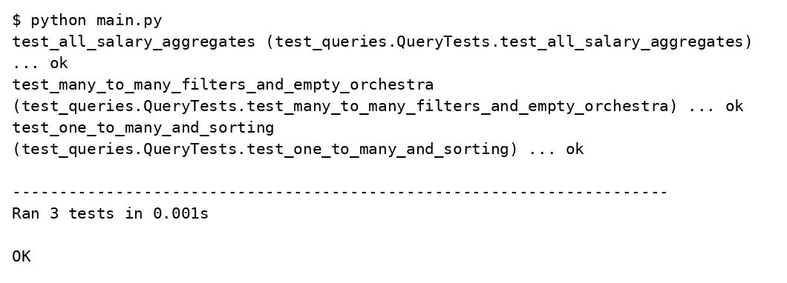

# Рубежный контроль 2

## Тестирование запросов по дирижёрам и оркестрам

Вариант 17

Студент: Леонтьев Д.А.

Группа: ИУ5-32Б

Преподаватель: Гапанюк Ю.Е.

Москва 2026

## Задание

Провести рефакторинг программы РК 1 для модульного тестирования и создать три теста с использованием TDD фреймворка.

## Решение

Модели, тестовые данные, запросы и консольный запуск РК 1 разделены на файлы. Функции возвращают данные, а не печатают их. РК 2 импортирует существующие функции без копирования. Три метода unittest проверяют соединение и сортировку, все шесть агрегатов, отношение многие ко многим, фильтры и пустой оркестр.

### assessments/rk_01/data.py

```python
from models import Conductor, Orchestra, ConductorOrchestra


def sample_data():
    orchestras = [Orchestra(1, 'Академический оркестр'),
                  Orchestra(2, 'Камерный оркестр'),
                  Orchestra(3, 'Симфонический оркестр')]
    conductors = [Conductor(1, 'Андреев', 80000, 1),
                  Conductor(2, 'Петров', 100000, 2),
                  Conductor(3, 'Иванов', 120000, 3),
                  Conductor(4, 'Сидоренко', 90000, 1),
                  Conductor(5, 'Алексеев', 110000, 3)]
    links = [ConductorOrchestra(1, 1), ConductorOrchestra(1, 4),
             ConductorOrchestra(2, 2), ConductorOrchestra(2, 1),
             ConductorOrchestra(3, 3)]
    return conductors, orchestras, links
```

### assessments/rk_01/models.py

```python
from dataclasses import dataclass


@dataclass
class Conductor:
    id: int
    surname: str
    salary: int
    orchestra_id: int


@dataclass
class Orchestra:
    id: int
    name: str


@dataclass
class ConductorOrchestra:
    orchestra_id: int
    conductor_id: int
```

### assessments/rk_01/queries.py

```python
def one_to_many(conductors, orchestras):
    return [(c.surname, c.salary, o.name) for o in orchestras
            for c in conductors if c.orchestra_id == o.id]


def many_to_many(conductors, orchestras, links):
    return [(c.surname, c.salary, o.name) for link in links
            for o in orchestras for c in conductors
            if link.orchestra_id == o.id and link.conductor_id == c.id]


def salary_statistics(rows, orchestras, operation):
    result = []
    for orchestra in orchestras:
        salaries = [salary for _, salary, name in rows if name == orchestra.name]
        if salaries or operation == 'count':
            operations = {'sum': sum, 'min': min, 'max': max, 'count': len,
                          'average': lambda values: sum(values) / len(values),
                          'rounded_average': lambda values: round(sum(values) / len(values), 2)}
            result.append((orchestra.name, operations[operation](salaries)))
    return sorted(result, key=lambda row: row[1], reverse=operation == 'sum')


def grouped(rows, orchestras, predicate):
    return {o.name: [surname for surname, _, name in rows if name == o.name]
            for o in orchestras if predicate(o.name.casefold())}


def run_queries(letter, conductors, orchestras, links):
    one = one_to_many(conductors, orchestras)
    many = many_to_many(conductors, orchestras, links)
    # Слово «отдел» из шаблона заменено словом «оркестр» предметной области.
    has_word = lambda name: 'оркестр' in name
    starts_a = lambda name: name.startswith('а')
    if letter == 'А':
        return (sorted(one, key=lambda row: row[2]),
                salary_statistics(one, orchestras, 'sum'),
                grouped(many, orchestras, has_word))
    if letter == 'Б':
        return (sorted(one, key=lambda row: row[0]),
                salary_statistics(one, orchestras, 'count'),
                [row for row in many if row[0].casefold().endswith('ов')])
    if letter == 'В':
        return ([row for row in one if row[0].casefold().startswith('а')],
                salary_statistics(one, orchestras, 'min'),
                sorted(many, key=lambda row: row[0]))
    if letter == 'Г':
        return (grouped(one, orchestras, starts_a),
                salary_statistics(one, orchestras, 'max'),
                sorted(many, key=lambda row: row[2]))
    if letter == 'Д':
        return ([row for row in one if row[0].casefold().endswith('ов')],
                salary_statistics(one, orchestras, 'average'),
                grouped(many, orchestras, starts_a))
    if letter == 'Е':
        return (grouped(one, orchestras, has_word),
                salary_statistics(one, orchestras, 'rounded_average'),
                [row for row in many if row[0].casefold().startswith('а')])
    raise ValueError('Допустимы наборы А, Б, В, Г, Д, Е')
```

### assessments/rk_02/main.py

```python
from test_queries import QueryTests
import unittest


if __name__ == '__main__':
    result = unittest.TextTestRunner(verbosity=2).run(
        unittest.defaultTestLoader.loadTestsFromTestCase(QueryTests))
    raise SystemExit(0 if result.wasSuccessful() else 1)
```

### assessments/rk_02/test_queries.py

```python
import sys
import unittest
from pathlib import Path

sys.path.insert(0, str(Path(__file__).resolve().parents[1] / 'rk_01'))
from data import sample_data
from models import Orchestra
from queries import run_queries, salary_statistics, one_to_many, many_to_many


class QueryTests(unittest.TestCase):
    def setUp(self):
        self.conductors, self.orchestras, self.links = sample_data()

    def test_one_to_many_and_sorting(self):
        expected = [('Андреев', 80000, 'Академический оркестр'),
                    ('Сидоренко', 90000, 'Академический оркестр'),
                    ('Петров', 100000, 'Камерный оркестр'),
                    ('Иванов', 120000, 'Симфонический оркестр'),
                    ('Алексеев', 110000, 'Симфонический оркестр')]
        results = run_queries('А', self.conductors, self.orchestras, self.links)
        self.assertEqual(results[0], expected)

    def test_all_salary_aggregates(self):
        expected = {'А': [230000, 170000, 100000], 'Б': [1, 2, 2],
                    'В': [80000, 100000, 110000], 'Г': [90000, 100000, 120000],
                    'Д': [85000, 100000, 115000], 'Е': [85000, 100000, 115000]}
        for letter, values in expected.items():
            with self.subTest(letter=letter):
                results = run_queries(letter, self.conductors, self.orchestras, self.links)
                self.assertEqual([value for _, value in results[1]], values)

    def test_many_to_many_filters_and_empty_orchestra(self):
        results = run_queries('Е', self.conductors, self.orchestras, self.links)
        self.assertEqual(results[2], [('Андреев', 80000, 'Академический оркестр'),
                                      ('Андреев', 80000, 'Камерный оркестр')])
        self.assertEqual(len(many_to_many(self.conductors, self.orchestras, self.links)), 5)
        empty = self.orchestras + [Orchestra(4, 'Пустой оркестр')]
        rows = one_to_many(self.conductors, empty)
        self.assertEqual(len(salary_statistics(rows, empty, 'average')), 3)
        with self.assertRaises(ValueError):
            run_queries('Ж', self.conductors, empty, self.links)


if __name__ == '__main__':
    unittest.main()
```

## Результаты выполнения



## Проверка результата

Все три теста РК 2 прошли. Вложенные subTest отдельно проверяют агрегацию каждого буквенного набора. Для пустого оркестра средняя зарплата не вычисляется, что предотвращает деление на ноль.

## Источники

https://github.com/ugapanyuk/courses_current/blob/main/python/rk/pcpl/pcpl_rk_2.pdf
