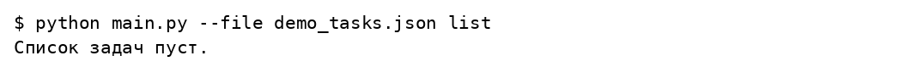
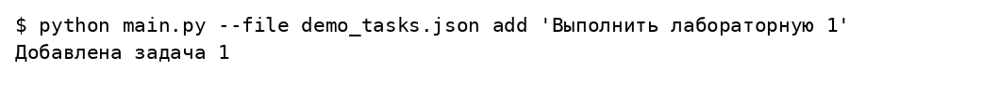
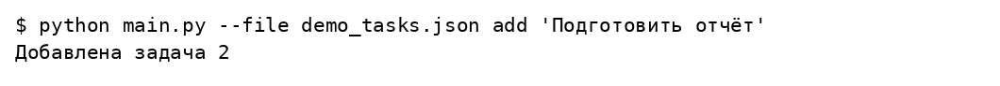
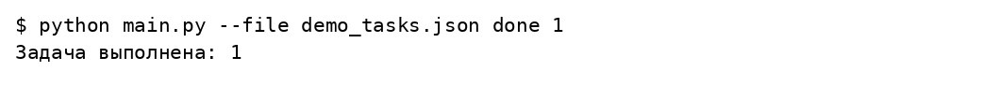
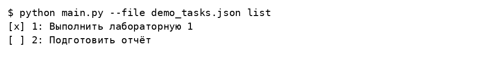
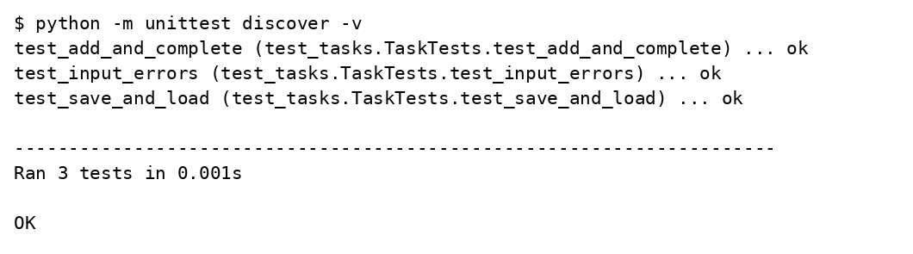

# Домашнее задание

## Список задач на Python с сохранением в JSON

Вариант 17

Студент ____________________

Группа ____________________

Преподаватель ____________________

Москва 2026

## Задание

Разработать небольшой проект с подробным описанием на выбранном языке программирования. Использовать особенности парадигмы и основные конструкции языка, установить интерпретатор и среду разработки, подробно комментировать код проекта.

## Решение

Проект использует процедурный подход, функции, списки, словари, генераторное выражение, контекстный менеджер файлов, исключения и argparse. Команды add, list и done добавляют, показывают и завершают задачи. Все данные сохраняются в JSON. Параметр --file позволяет выбрать отдельное хранилище.

### homework/01_task_manager/main.py

```python
import argparse
import json
from pathlib import Path


def load_tasks(path):
    """Если файл ещё не создан, начинаем с пустого списка."""
    path = Path(path)
    if not path.exists():
        return []
    with path.open(encoding='utf-8') as file:
        tasks = json.load(file)
    if not isinstance(tasks, list):
        raise ValueError('В файле должен находиться список задач')
    for task in tasks:
        if (not isinstance(task, dict) or not isinstance(task.get('id'), int)
                or not isinstance(task.get('title'), str)
                or not isinstance(task.get('done'), bool)):
            raise ValueError('Неверная структура задачи в файле')
    return tasks


def save_tasks(path, tasks):
    """Сохраняем данные в читаемом UTF-8 JSON."""
    with Path(path).open('w', encoding='utf-8') as file:
        json.dump(tasks, file, ensure_ascii=False, indent=2)


def add_task(tasks, title):
    """ID не зависит от позиции задачи в списке."""
    title = title.strip()
    if not title:
        raise ValueError('Название не должно быть пустым')
    task_id = max((task['id'] for task in tasks), default=0) + 1
    tasks.append({'id': task_id, 'title': title, 'done': False})
    return task_id


def complete_task(tasks, task_id):
    for task in tasks:
        if task['id'] == task_id:
            task['done'] = True
            return
    raise ValueError('Задача не найдена')


def main():
    parser = argparse.ArgumentParser(description='Учебный список задач')
    parser.add_argument('--file', default='tasks.json')
    commands = parser.add_subparsers(dest='command', required=True)
    add = commands.add_parser('add')
    add.add_argument('title')
    commands.add_parser('list')
    done = commands.add_parser('done')
    done.add_argument('id', type=int)
    arguments = parser.parse_args()
    try:
        tasks = load_tasks(arguments.file)
        if arguments.command == 'add':
            print('Добавлена задача', add_task(tasks, arguments.title))
            save_tasks(arguments.file, tasks)
        elif arguments.command == 'done':
            complete_task(tasks, arguments.id)
            save_tasks(arguments.file, tasks)
            print('Задача выполнена:', arguments.id)
        else:
            for task in tasks:
                mark = 'x' if task['done'] else ' '
                print(f"[{mark}] {task['id']}: {task['title']}")
            if not tasks:
                print('Список задач пуст.')
    except (ValueError, OSError) as error:
        parser.exit(1, f'Ошибка: {error}\n')


if __name__ == '__main__':
    main()
```

### homework/01_task_manager/test_tasks.py

```python
import unittest
from pathlib import Path
from tempfile import TemporaryDirectory
from main import load_tasks, save_tasks, add_task, complete_task


class TaskTests(unittest.TestCase):
    def test_add_and_complete(self):
        tasks = []
        self.assertEqual(add_task(tasks, 'Прочитать задание'), 1)
        complete_task(tasks, 1)
        self.assertTrue(tasks[0]['done'])

    def test_save_and_load(self):
        with TemporaryDirectory() as directory:
            path = Path(directory) / 'tasks.json'
            self.assertEqual(load_tasks(path), [])
            tasks = []
            add_task(tasks, 'Лабораторная 1')
            save_tasks(path, tasks)
            self.assertEqual(load_tasks(path), tasks)

    def test_input_errors(self):
        with self.assertRaises(ValueError):
            add_task([], ' ')
        with self.assertRaises(ValueError):
            complete_task([], 17)
```

## Результаты выполнения













## Проверка результата

Созданы две задачи, первая отмечена выполненной; данные читаются при следующих запусках. Три теста проверяют добавление, изменение состояния, сохранение и ошибочные команды. Проект демонстрирует процедурный подход, работу с коллекциями, файлами и исключениями.

## Источники

https://github.com/ugapanyuk/courses_content/wiki/DZ
