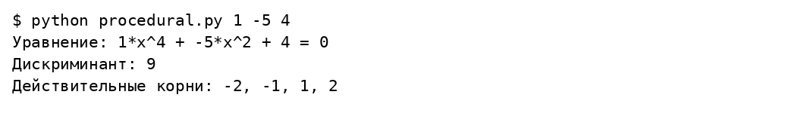
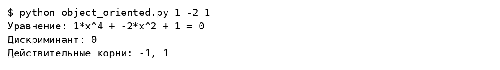
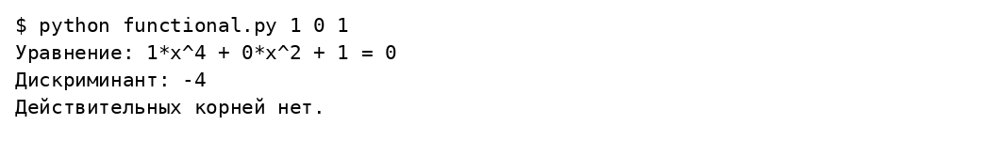
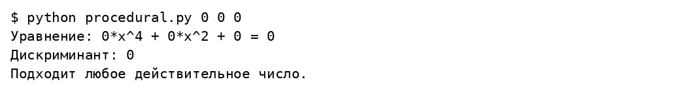
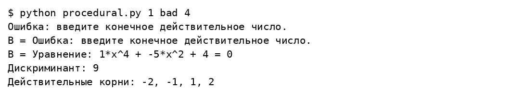
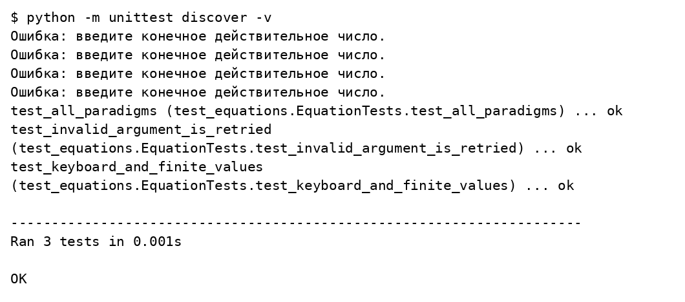

# Лабораторная работа 1

## Основные конструкции языка Python

Вариант 17

Студент ____________________

Группа ____________________

Преподаватель ____________________

Москва 2026

## Задание

Разработать три консольные программы решения биквадратного уравнения: процедурную, объектно ориентированную и функциональную с сопоставлением с образцом. Читать коэффициенты из аргументов или с клавиатуры, повторять ошибочный ввод и выводить дискриминант и действительные корни.

## Решение

Замена t = x² сводит уравнение A x⁴ + B x² + C = 0 к квадратному. Из неотрицательных значений t получаются корни ±√t. Множество удаляет повторяющиеся корни. Отдельно обработаны A = 0 и B = 0. Общий модуль отвечает только за ввод и вывод, а способы решения представлены в трёх файлах.

### labs/01_basics/functional.py

```python
from math import sqrt
from input_output import read_coefficients, show_result


def solve(a, b, c):
    """Чистая функция с сопоставлением с образцом Python 3.10+."""
    match (a, b, c):
        case (0, 0, 0):
            return None
        case (0, 0, _):
            return []
        case (0, _, _):
            values = [-c / b]
        case _:
            d = b * b - 4 * a * c
            match d:
                case _ if d < 0:
                    return []
                case _:
                    values = [(-b + sqrt(d)) / (2 * a),
                              (-b - sqrt(d)) / (2 * a)]
    return sorted({x for t in filter(lambda t: t >= 0, values)
                   for x in (-sqrt(t), sqrt(t))})


if __name__ == '__main__':
    a, b, c = read_coefficients()
    show_result(a, b, c, solve(a, b, c))
```

### labs/01_basics/input_output.py

```python
import math
import sys


def read_coefficients(arguments=None):
    arguments = sys.argv[1:] if arguments is None else arguments
    values = []
    for index, name in enumerate(('A', 'B', 'C')):
        raw = arguments[index] if index < len(arguments) else None
        while True:
            if raw is None:
                raw = input(f'{name} = ')
            try:
                value = float(raw)
                if not math.isfinite(value):
                    raise ValueError
                values.append(value)
                break
            except ValueError:
                print('Ошибка: введите конечное действительное число.')
                raw = None
    return values


def show_result(a, b, c, roots):
    print(f'Уравнение: {a:g}*x^4 + {b:g}*x^2 + {c:g} = 0')
    print(f'Дискриминант: {b * b - 4 * a * c:g}')
    if roots is None:
        print('Подходит любое действительное число.')
    elif roots:
        print('Действительные корни:', ', '.join(f'{x:g}' for x in roots))
    else:
        print('Действительных корней нет.')
```

### labs/01_basics/object_oriented.py

```python
from math import sqrt
from input_output import read_coefficients, show_result


class BiquadraticEquation:
    def __init__(self, a, b, c):
        self.a, self.b, self.c = a, b, c

    def discriminant(self):
        return self.b ** 2 - 4 * self.a * self.c

    def solve(self):
        a, b, c = self.a, self.b, self.c
        if a == 0 and b == 0:
            return None if c == 0 else []
        if a == 0:
            values = [-c / b]
        else:
            d = self.discriminant()
            if d < 0:
                return []
            values = [(-b + sqrt(d)) / (2 * a), (-b - sqrt(d)) / (2 * a)]
        return sorted({root for t in values if t >= 0
                       for root in (-sqrt(t), sqrt(t))})


if __name__ == '__main__':
    a, b, c = read_coefficients()
    equation = BiquadraticEquation(a, b, c)
    show_result(a, b, c, equation.solve())
```

### labs/01_basics/procedural.py

```python
from math import sqrt
from input_output import read_coefficients, show_result


def solve(a, b, c):
    """Замена t = x^2; None означает бесконечно много корней."""
    if a == 0:
        if b == 0:
            return None if c == 0 else []
        values = [-c / b]
    else:
        d = b * b - 4 * a * c
        if d < 0:
            return []
        values = [(-b + sqrt(d)) / (2 * a), (-b - sqrt(d)) / (2 * a)]
    roots = set()
    for value in values:
        if value >= 0:
            roots.update((-sqrt(value), sqrt(value)))
    return sorted(roots)


if __name__ == '__main__':
    a, b, c = read_coefficients()
    show_result(a, b, c, solve(a, b, c))
```

### labs/01_basics/test_equations.py

```python
import unittest
from unittest.mock import patch
from procedural import solve
from functional import solve as functional_solve
from object_oriented import BiquadraticEquation
from input_output import read_coefficients


class EquationTests(unittest.TestCase):
    def test_all_paradigms(self):
        examples = [(1, -5, 4, [-2, -1, 1, 2]), (1, 0, 1, []),
                    (1, -2, 1, [-1, 1]), (1, 1, 0, [0]),
                    (0, 2, -8, [-2, 2]), (0, 0, 0, None),
                    (0, 0, 2, []), (1, 5, 4, [])]
        for a, b, c, expected in examples:
            with self.subTest(coefficients=(a, b, c)):
                self.assertEqual(solve(a, b, c), expected)
                self.assertEqual(functional_solve(a, b, c), expected)
                self.assertEqual(BiquadraticEquation(a, b, c).solve(), expected)

    @patch('builtins.input', side_effect=['bad', '2'])
    def test_invalid_argument_is_retried(self, mocked_input):
        self.assertEqual(read_coefficients(['1', 'wrong', '4']), [1, 2, 4])

    @patch('builtins.input', side_effect=['nan', 'inf', '1', '-5', '4'])
    def test_keyboard_and_finite_values(self, mocked_input):
        self.assertEqual(read_coefficients([]), [1, -5, 4])


if __name__ == '__main__':
    unittest.main()
```

## Результаты выполнения













## Проверка результата

Все три подхода дают одинаковые корни на проверенных наборах. Для коэффициентов 1, −5, 4 получены четыре корня: −2, −1, 1, 2. Проверены отрицательный дискриминант, повторные корни, нулевой корень, вырожденные случаи и повторный ввод.

## Источники

https://github.com/ugapanyuk/BKIT_2022/wiki/lab_python_intro
