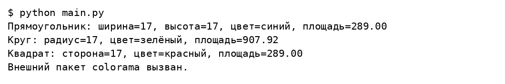
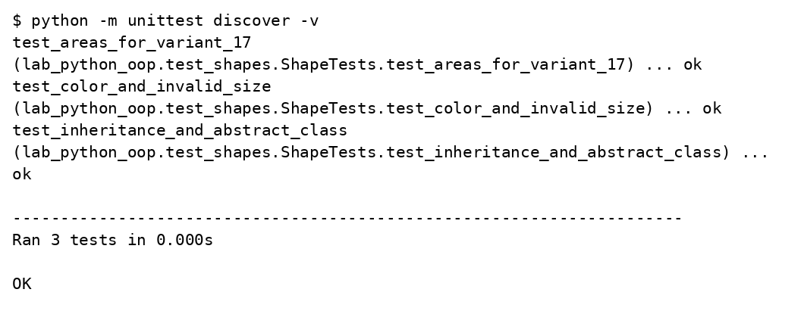

# Лабораторная работа 2

## Объектно ориентированные возможности Python

Вариант 17

Студент ____________________

Группа ____________________

Преподаватель ____________________

Москва 2026

## Задание

Создать абстрактный класс фигуры, класс цвета со свойством, классы прямоугольника и круга и производный от прямоугольника квадрат. Каждый класс находится в отдельном файле пакета lab_python_oop. Использовать format, поле класса с названием и метод класса. Установить внешний пакет в виртуальное окружение и вызвать его метод.

## Решение

Для N = 17 создаются синий прямоугольник 17 × 17, зелёный круг радиуса 17 и красный квадрат со стороной 17. Color хранится как отдельный объект. Метод area переопределяется, а Square наследует расчёт площади Rectangle. Внешний пакет colorama используется для настройки консоли и цветного сообщения.

### labs/02_oop/lab_python_oop/circle.py

```python
from math import pi
from .shape import Shape
from .color import Color


class Circle(Shape):
    name = 'Круг'

    def __init__(self, radius, color):
        if radius <= 0:
            raise ValueError('Радиус должен быть положительным')
        self.radius = radius
        self.color = Color(color)

    def area(self):
        return pi * self.radius ** 2

    def __repr__(self):
        return '{}: радиус={}, цвет={}, площадь={:.2f}'.format(
            self.get_name(), self.radius, self.color.value, self.area())
```

### labs/02_oop/lab_python_oop/color.py

```python
class Color:
    def __init__(self, value):
        self.value = value

    @property
    def value(self):
        return self._value

    @value.setter
    def value(self, value):
        if not isinstance(value, str) or not value.strip():
            raise ValueError('Цвет должен быть непустой строкой')
        self._value = value.strip()
```

### labs/02_oop/lab_python_oop/rectangle.py

```python
from .shape import Shape
from .color import Color


class Rectangle(Shape):
    name = 'Прямоугольник'

    def __init__(self, width, height, color):
        if width <= 0 or height <= 0:
            raise ValueError('Размеры должны быть положительными')
        self.width, self.height = width, height
        self.color = Color(color)

    def area(self):
        return self.width * self.height

    def __repr__(self):
        return '{}: ширина={}, высота={}, цвет={}, площадь={:.2f}'.format(
            self.get_name(), self.width, self.height,
            self.color.value, self.area())
```

### labs/02_oop/lab_python_oop/shape.py

```python
from abc import ABC, abstractmethod


class Shape(ABC):
    name = 'Геометрическая фигура'

    @classmethod
    def get_name(cls):
        return cls.name

    @abstractmethod
    def area(self):
        pass
```

### labs/02_oop/lab_python_oop/square.py

```python
from .rectangle import Rectangle


class Square(Rectangle):
    name = 'Квадрат'

    def __init__(self, side, color):
        super().__init__(side, side, color)

    def __repr__(self):
        return '{}: сторона={}, цвет={}, площадь={:.2f}'.format(
            self.get_name(), self.width, self.color.value, self.area())
```

### labs/02_oop/main.py

```python
from colorama import just_fix_windows_console, Fore, Style
from lab_python_oop.rectangle import Rectangle
from lab_python_oop.circle import Circle
from lab_python_oop.square import Square


if __name__ == '__main__':
    just_fix_windows_console()
    figures = [Rectangle(17, 17, 'синий'), Circle(17, 'зелёный'),
               Square(17, 'красный')]
    for figure in figures:
        print(figure)
    print(Fore.GREEN + 'Внешний пакет colorama вызван.' + Style.RESET_ALL)
```

### labs/02_oop/lab_python_oop/test_shapes.py

```python
import unittest
from math import pi
from .shape import Shape
from .rectangle import Rectangle
from .square import Square
from .circle import Circle
from .color import Color


class ShapeTests(unittest.TestCase):
    def test_areas_for_variant_17(self):
        self.assertEqual(Rectangle(17, 17, 'синий').area(), 289)
        self.assertEqual(Square(17, 'красный').area(), 289)
        self.assertAlmostEqual(Circle(17, 'зелёный').area(), 289 * pi)

    def test_inheritance_and_abstract_class(self):
        self.assertIsInstance(Square(17, 'красный'), Rectangle)
        with self.assertRaises(TypeError):
            Shape()

    def test_color_and_invalid_size(self):
        color = Color('синий')
        color.value = 'красный'
        self.assertEqual(color.value, 'красный')
        with self.assertRaises(ValueError):
            Circle(-1, 'синий')
```

## Результаты выполнения





## Проверка результата

Площади прямоугольника и квадрата равны 289. Площадь круга равна 289π, приблизительно 907,92. Модульные тесты проверяют площади, наследование, абстрактность и проверку размеров.

## Источники

https://github.com/ugapanyuk/BKIT_2022/wiki/lab_python_oop
