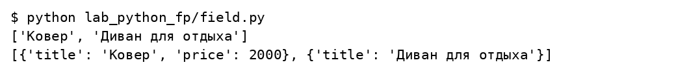
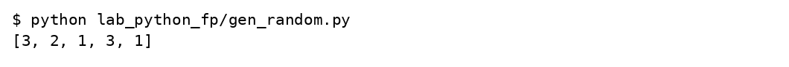
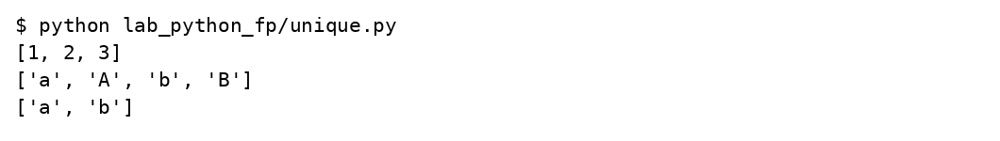
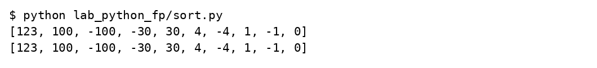
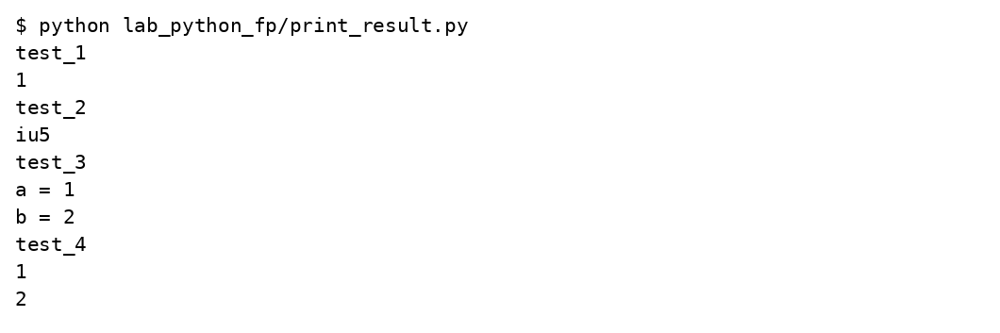
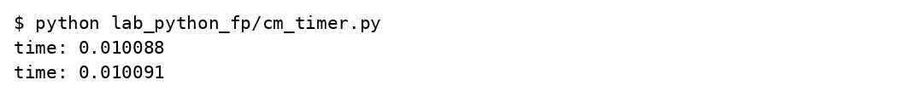
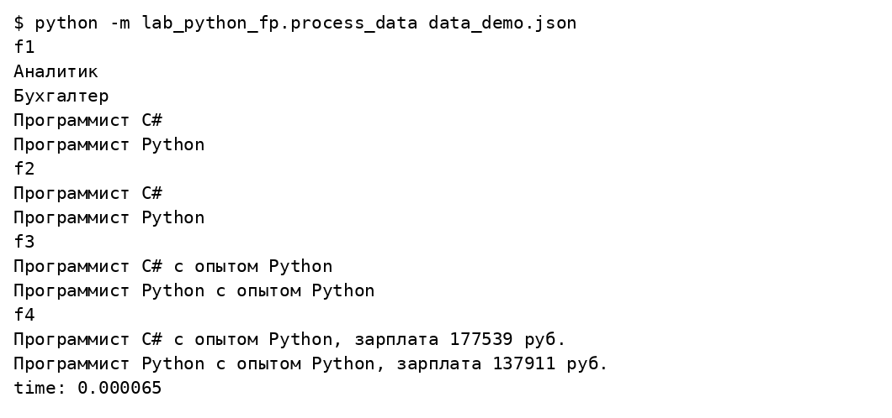
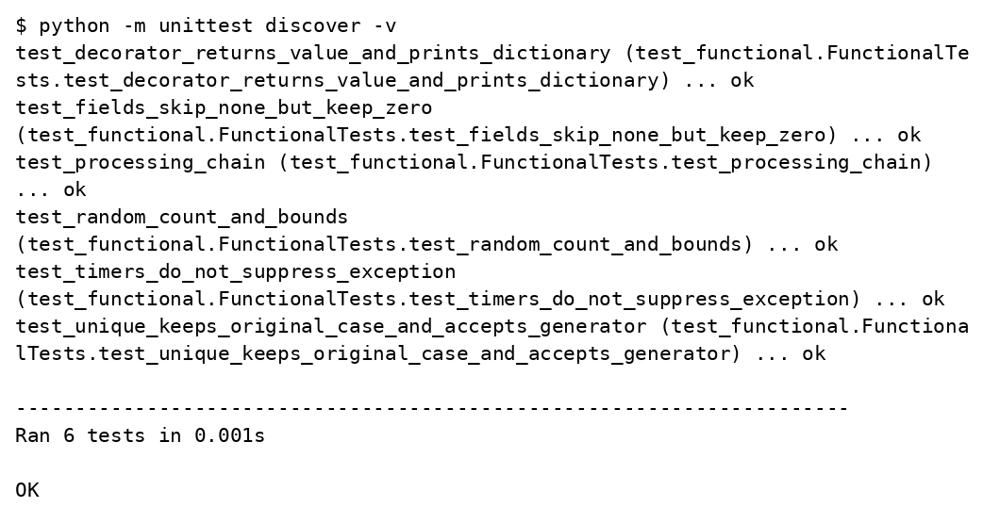

# Лабораторная работа 3

## Функциональные возможности Python

Вариант 17

Студент ____________________

Группа ____________________

Преподаватель ____________________

Москва 2026

## Задание

Решить все семь задач: генератор field, генератор случайных чисел, итератор Unique, две сортировки по модулю, декоратор print_result, два контекстных менеджера времени и цепочка f1–f4 для обработки вакансий. Функции f1–f3 содержат по одному выражению, f4 использует zip и генератор зарплат.

## Решение

field пропускает None и отсутствующие поля, сохраняя нулевые значения. Unique принимает список или генератор и сравнивает строки без учёта регистра при ignore_case=True, сохраняя исходное написание. Декоратор возвращает результат функции. Таймеры не подавляют исключения. Цепочка вакансий использует job-name из исходного учебного набора.

### labs/03_functional/lab_python_fp/field.py

```python
def field(items, *args):
    assert len(args) > 0
    for item in items:
        if len(args) == 1:
            value = item.get(args[0])
            if value is not None:
                yield value
        else:
            values = {key: item[key] for key in args
                      if item.get(key) is not None}
            if values:
                yield values


if __name__ == '__main__':
    goods = [{'title': 'Ковер', 'price': 2000},
             {'title': 'Диван для отдыха', 'color': 'black'},
             {'title': None, 'price': None}]
    print(list(field(goods, 'title')))
    print(list(field(goods, 'title', 'price')))
```

### labs/03_functional/lab_python_fp/gen_random.py

```python
from random import randint


def gen_random(num_count, begin, end):
    for _ in range(num_count):
        yield randint(begin, end)


if __name__ == '__main__':
    print(list(gen_random(5, 1, 3)))
```

### labs/03_functional/lab_python_fp/unique.py

```python
class Unique:
    def __init__(self, items, **kwargs):
        self.items = iter(items)
        self.ignore_case = kwargs.get('ignore_case', False)
        self.seen = []

    def __iter__(self):
        return self

    def __next__(self):
        for item in self.items:
            key = item.casefold() if self.ignore_case and isinstance(item, str) else item
            if key not in self.seen:
                self.seen.append(key)
                return item
        raise StopIteration


if __name__ == '__main__':
    print(list(Unique([1, 1, 2, 3, 2])))
    print(list(Unique(x for x in ['a', 'A', 'b', 'B'])))
    print(list(Unique(['a', 'A', 'b', 'B'], ignore_case=True)))
```

### labs/03_functional/lab_python_fp/sort.py

```python
data = [4, -30, 30, 100, -100, 123, 1, 0, -1, -4]


if __name__ == '__main__':
    print(sorted(data, key=lambda x: abs(x), reverse=True))
    print(sorted(data, key=abs, reverse=True))
```

### labs/03_functional/lab_python_fp/print_result.py

```python
from functools import wraps


def print_result(function):
    @wraps(function)
    def wrapper(*args, **kwargs):
        result = function(*args, **kwargs)
        print(function.__name__)
        if isinstance(result, dict):
            for key, value in result.items():
                print(f'{key} = {value}')
        elif isinstance(result, list):
            for value in result:
                print(value)
        else:
            print(result)
        return result
    return wrapper


@print_result
def test_1():
    return 1


@print_result
def test_2():
    return 'iu5'


@print_result
def test_3():
    return {'a': 1, 'b': 2}


@print_result
def test_4():
    return [1, 2]


if __name__ == '__main__':
    test_1()
    test_2()
    test_3()
    test_4()
```

### labs/03_functional/lab_python_fp/cm_timer.py

```python
from contextlib import contextmanager
from time import perf_counter, sleep


class cm_timer_1:
    def __enter__(self):
        self.started = perf_counter()
        return self

    def __exit__(self, exc_type, exc_value, traceback):
        print(f'time: {perf_counter() - self.started:.6f}')
        return False


@contextmanager
def cm_timer_2():
    started = perf_counter()
    try:
        yield
    finally:
        print(f'time: {perf_counter() - started:.6f}')


if __name__ == '__main__':
    with cm_timer_1():
        sleep(0.01)
    with cm_timer_2():
        sleep(0.01)
```

### labs/03_functional/lab_python_fp/process_data.py

```python
import json
import sys
if __package__:
    from .field import field
    from .unique import Unique
    from .gen_random import gen_random
    from .print_result import print_result
    from .cm_timer import cm_timer_1
else:
    from field import field
    from unique import Unique
    from gen_random import gen_random
    from print_result import print_result
    from cm_timer import cm_timer_1


@print_result
def f1(arg):
    return sorted(Unique(field(arg, 'job-name'), ignore_case=True), key=str.casefold)


@print_result
def f2(arg):
    return list(filter(lambda name: name.casefold().startswith('программист'), arg))


@print_result
def f3(arg):
    return list(map(lambda name: name + ' с опытом Python', arg))


@print_result
def f4(arg):
    return [f'{name}, зарплата {salary} руб.'
            for name, salary in zip(arg, gen_random(len(arg), 100000, 200000))]


if __name__ == '__main__':
    if len(sys.argv) != 2:
        raise SystemExit('Запуск: python -m lab_python_fp.process_data data_light.json')
    with open(sys.argv[1], encoding='utf-8') as file:
        data = json.load(file)
    with cm_timer_1():
        f4(f3(f2(f1(data))))
```

### labs/03_functional/unpack_data.py

```python
"""Распаковать исходный учебный набор без дополнительных библиотек."""
import gzip
from pathlib import Path

directory = Path(__file__).resolve().parent
with gzip.open(directory / 'data_light.json.gz', 'rb') as source:
    (directory / 'data_light.json').write_bytes(source.read())
print('Готово: data_light.json')
```

### labs/03_functional/test_functional.py

```python
import unittest
from io import StringIO
from contextlib import redirect_stdout
from lab_python_fp.field import field
from lab_python_fp.unique import Unique
from lab_python_fp.gen_random import gen_random
from lab_python_fp.print_result import print_result
from lab_python_fp.cm_timer import cm_timer_1, cm_timer_2
from lab_python_fp.process_data import f1, f2, f3, f4


class FunctionalTests(unittest.TestCase):
    def test_fields_skip_none_but_keep_zero(self):
        items = [{'a': 0, 'b': None}, {}, {'a': 2, 'b': 3}]
        self.assertEqual(list(field(items, 'a')), [0, 2])
        self.assertEqual(list(field(items, 'a', 'b')), [{'a': 0}, {'a': 2, 'b': 3}])
        with self.assertRaises(AssertionError):
            list(field(items))

    def test_unique_keeps_original_case_and_accepts_generator(self):
        data = (x for x in ['A', 'a', 'B', 'b'])
        self.assertEqual(list(Unique(data, ignore_case=True)), ['A', 'B'])
        self.assertEqual(list(Unique(['A', 'a'])), ['A', 'a'])

    def test_random_count_and_bounds(self):
        values = list(gen_random(100, 1, 3))
        self.assertEqual(len(values), 100)
        self.assertTrue(all(1 <= value <= 3 for value in values))
        self.assertEqual(list(gen_random(2, 5, 5)), [5, 5])

    def test_decorator_returns_value_and_prints_dictionary(self):
        output = StringIO()
        with redirect_stdout(output):
            result = print_result(lambda: {'a': 1})()
        self.assertEqual(result, {'a': 1})
        self.assertIn('a = 1', output.getvalue())

    def test_timers_do_not_suppress_exception(self):
        for timer in [cm_timer_1, cm_timer_2]:
            with self.assertRaises(ValueError), redirect_stdout(StringIO()):
                with timer():
                    raise ValueError('ошибка')

    def test_processing_chain(self):
        data = [{'job-name': 'Программист C#'}, {'job-name': 'программист c#'},
                {'job-name': 'Бухгалтер'}]
        with redirect_stdout(StringIO()):
            names = f3(f2(f1(data)))
            rows = f4(names)
        self.assertEqual(names, ['Программист C# с опытом Python'])
        self.assertEqual(len(rows), 1)
        salary = int(rows[0].split('зарплата ')[1].split()[0])
        self.assertTrue(100000 <= salary <= 200000)
```

## Результаты выполнения


















## Проверка результата

Все семь задач выполнены. Цепочка отдельно запущена на полном исходном data_light.json; исходный файл хранится без изменений в архиве gzip. Случайные зарплаты попадают в диапазон 100000–200000. Результаты случайного генератора и время при повторном запуске изменяются.

## Источники

https://github.com/ugapanyuk/BKIT_2022/wiki/lab_python_fp
