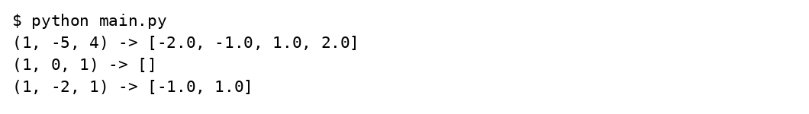
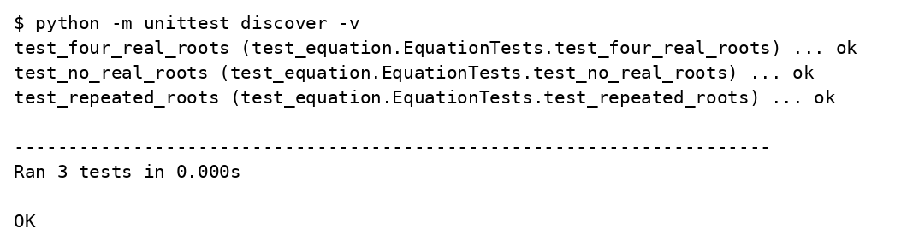
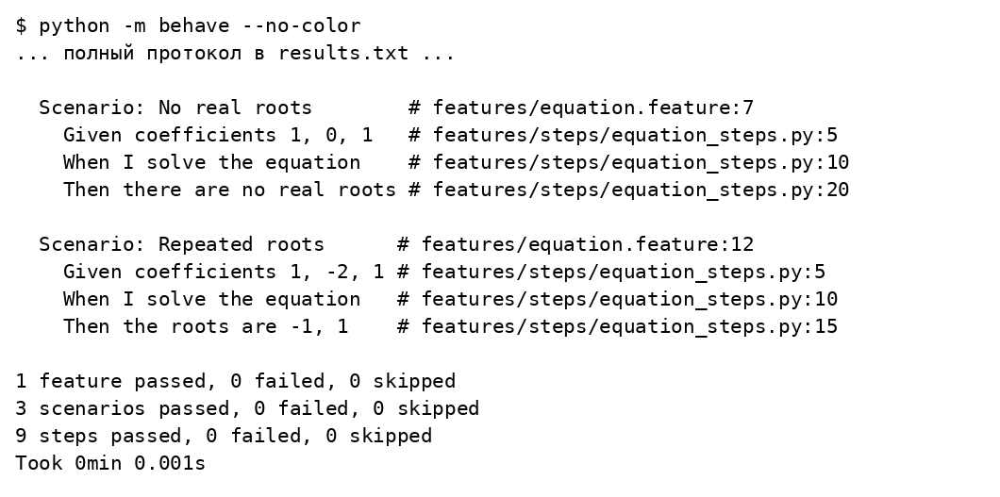

# Лабораторная работа 4

## Модульное тестирование в Python

Вариант 17

Студент: Леонтьев Д.А.

Группа: ИУ5-32Б

Преподаватель: Гапанюк Ю.Е.

Москва 2026

## Задание

Выбрать фрагмент одной из предыдущих работ, сделать его пригодным для независимого тестирования и разработать не менее трёх тестов в TDD фреймворке и не менее трёх сценариев в BDD фреймворке.

## Решение

Из процедурного решателя ЛР 1 выделена чистая функция solve без ввода с клавиатуры и вывода. unittest проверяет четыре действительных корня, отсутствие действительных корней и кратные корни. Те же примеры описаны в Gherkin и исполняются настоящим BDD фреймворком behave.

### labs/04_testing/equation.py

```python
from math import sqrt


def solve(a, b, c):
    """Замена t = x^2; None означает бесконечно много корней."""
    if a == 0:
        if b == 0:
            return None if c == 0 else []
        values = [-c / b]
    else:
        d = b * b - 4 * a * c
        if d < 0:
            return []
        values = [(-b + sqrt(d)) / (2 * a), (-b - sqrt(d)) / (2 * a)]
    roots = set()
    for value in values:
        if value >= 0:
            roots.update((-sqrt(value), sqrt(value)))
    return sorted(roots)
```

### labs/04_testing/features/equation.feature

```gherkin
Feature: Biquadratic equation
  Scenario: Four real roots
    Given coefficients 1, -5, 4
    When I solve the equation
    Then the roots are -2, -1, 1, 2

  Scenario: No real roots
    Given coefficients 1, 0, 1
    When I solve the equation
    Then there are no real roots

  Scenario: Repeated roots
    Given coefficients 1, -2, 1
    When I solve the equation
    Then the roots are -1, 1
```

### labs/04_testing/features/steps/equation_steps.py

```python
from behave import given, when, then
from equation import solve


@given('coefficients {a}, {b}, {c}')
def coefficients(context, a, b, c):
    context.coefficients = tuple(map(float, (a, b, c)))


@when('I solve the equation')
def calculate(context):
    context.roots = solve(*context.coefficients)


@then('the roots are {values}')
def roots(context, values):
    assert context.roots == [float(value) for value in values.split(',')]


@then('there are no real roots')
def no_roots(context):
    assert context.roots == []
```

### labs/04_testing/main.py

```python
from equation import solve


if __name__ == '__main__':
    for coefficients in [(1, -5, 4), (1, 0, 1), (1, -2, 1)]:
        print(coefficients, '->', solve(*coefficients))
```

### labs/04_testing/test_equation.py

```python
import unittest
from equation import solve


class EquationTests(unittest.TestCase):
    def test_four_real_roots(self):
        self.assertEqual(solve(1, -5, 4), [-2, -1, 1, 2])

    def test_no_real_roots(self):
        self.assertEqual(solve(1, 0, 1), [])

    def test_repeated_roots(self):
        self.assertEqual(solve(1, -2, 1), [-1, 1])


if __name__ == '__main__':
    unittest.main()
```

## Результаты выполнения







## Проверка результата

Прошли три теста unittest и три сценария behave. Проверки вызывают функцию напрямую и не зависят от консоли.

## Источники

https://github.com/ugapanyuk/BKIT_2022/wiki/lab_python_test
