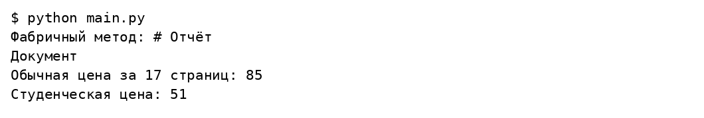
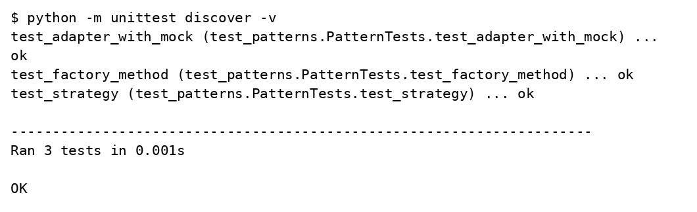
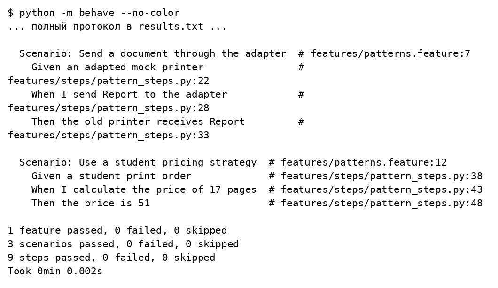

# Лабораторная работа 5

## Шаблоны проектирования и тестирование

Вариант 17

Студент: Леонтьев Д.А.

Группа: ИУ5-32Б

Преподаватель: Гапанюк Ю.Е.

Москва 2026

## Задание

Для произвольной предметной области реализовать порождающий, структурный и поведенческий шаблоны. Применить TDD фреймворк, BDD фреймворк и Mock объекты при тестировании.

## Решение

Предметная область — печать учебных документов. Фабричный метод создаёт текстовый или Markdown документ через подклассы создателя. Адаптер переводит вызов send в print_line старого принтера. Стратегия задаёт обычную или студенческую стоимость печати. Mock проверяет ровно один вызов принтера с нужной строкой.

### labs/05_patterns/features/patterns.feature

```gherkin
Feature: Printing documents
  Scenario: Create a Markdown document
    Given a Markdown creator
    When I render the title Report
    Then the document is # Report

  Scenario: Send a document through the adapter
    Given an adapted mock printer
    When I send Report to the adapter
    Then the old printer receives Report

  Scenario: Use a student pricing strategy
    Given a student print order
    When I calculate the price of 17 pages
    Then the price is 51
```

### labs/05_patterns/features/steps/pattern_steps.py

```python
from behave import given, when, then
from unittest.mock import Mock
from patterns import (MarkdownCreator, LegacyPrinter, PrinterAdapter,
                      PrintOrder, student_price)


@given('a Markdown creator')
def creator(context):
    context.creator = MarkdownCreator()


@when('I render the title {title}')
def render(context, title):
    context.document = context.creator.render(title)


@then('the document is {text}')
def document(context, text):
    assert context.document == text


@given('an adapted mock printer')
def printer(context):
    context.printer = Mock(spec=LegacyPrinter)
    context.adapter = PrinterAdapter(context.printer)


@when('I send {text} to the adapter')
def send(context, text):
    context.adapter.send(text)


@then('the old printer receives {text}')
def received(context, text):
    context.printer.print_line.assert_called_once_with(text)


@given('a student print order')
def order(context):
    context.order = PrintOrder(student_price)


@when('I calculate the price of {pages:d} pages')
def price(context, pages):
    context.price = context.order.total(pages)


@then('the price is {expected:d}')
def expected_price(context, expected):
    assert context.price == expected
```

### labs/05_patterns/main.py

```python
from patterns import (TextCreator, MarkdownCreator, LegacyPrinter,
                      PrinterAdapter, PrintOrder, student_price)


if __name__ == '__main__':
    print('Фабричный метод:', MarkdownCreator().render('Отчёт'))
    PrinterAdapter(LegacyPrinter()).send(TextCreator().render('Документ'))
    print('Обычная цена за 17 страниц:', PrintOrder().total(17))
    print('Студенческая цена:', PrintOrder(student_price).total(17))
```

### labs/05_patterns/patterns.py

```python
from abc import ABC, abstractmethod


class PlainText:
    def render(self, title):
        return title


class Markdown:
    def render(self, title):
        return '# ' + title


class DocumentCreator(ABC):
    """Фабричный метод: подклассы выбирают тип документа."""
    @abstractmethod
    def create_document(self):
        pass

    def render(self, title):
        return self.create_document().render(title)


class TextCreator(DocumentCreator):
    def create_document(self):
        return PlainText()


class MarkdownCreator(DocumentCreator):
    def create_document(self):
        return Markdown()


class LegacyPrinter:
    def print_line(self, text):
        print(text)


class PrinterAdapter:
    """Адаптер согласует send с методом старого принтера print_line."""
    def __init__(self, printer):
        self.printer = printer

    def send(self, text):
        self.printer.print_line(text)


def regular_price(pages):
    return pages * 5


def student_price(pages):
    return pages * 3


class PrintOrder:
    """Стратегия расчёта цены передаётся как функция."""
    def __init__(self, pricing=regular_price):
        self.pricing = pricing

    def total(self, pages):
        if pages < 0:
            raise ValueError('Число страниц не может быть отрицательным')
        return self.pricing(pages)
```

### labs/05_patterns/test_patterns.py

```python
import unittest
from unittest.mock import Mock
from patterns import (TextCreator, MarkdownCreator, PrinterAdapter,
                      LegacyPrinter, PrintOrder, student_price)


class PatternTests(unittest.TestCase):
    def test_factory_method(self):
        self.assertEqual(TextCreator().render('Отчёт'), 'Отчёт')
        self.assertEqual(MarkdownCreator().render('Отчёт'), '# Отчёт')

    def test_adapter_with_mock(self):
        printer = Mock(spec=LegacyPrinter)
        PrinterAdapter(printer).send('Отчёт')
        printer.print_line.assert_called_once_with('Отчёт')

    def test_strategy(self):
        self.assertEqual(PrintOrder().total(17), 85)
        self.assertEqual(PrintOrder(student_price).total(17), 51)
        with self.assertRaises(ValueError):
            PrintOrder().total(-1)


if __name__ == '__main__':
    unittest.main()
```

## Результаты выполнения







## Проверка результата

Реализованы три категории шаблонов. Три теста unittest и три сценария behave прошли успешно. При 17 страницах обычная цена равна 85, студенческая — 51.

## Источники

https://github.com/ugapanyuk/BKIT_2021/wiki/lab_python_test
