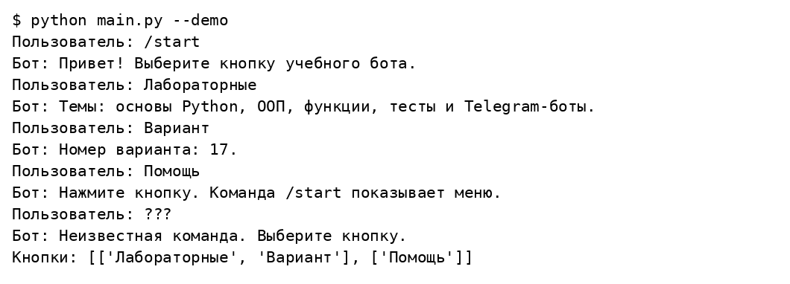
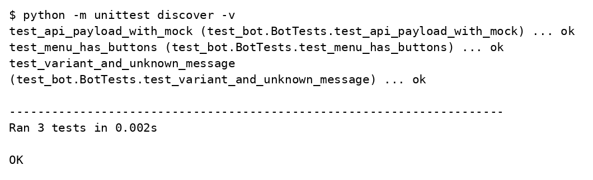

# Лабораторная работа 6

## Простой Telegram бот с кнопками

Вариант 17

Студент ____________________

Группа ____________________

Преподаватель ____________________

Москва 2026

## Задание

Разработать простого Telegram бота на Python, использующего функциональность создания кнопок.

## Решение

Учебный бот показывает reply клавиатуру с кнопками Лабораторные, Вариант и Помощь. Функция reply формирует ответ и клавиатуру, а отдельный модуль выполняет getUpdates и sendMessage через стандартный urllib. Секретный токен читается из TELEGRAM_BOT_TOKEN и не записывается в исходники.

### labs/06_bot/bot.py

```python
KEYBOARD = {'keyboard': [['Лабораторные', 'Вариант'], ['Помощь']],
            'resize_keyboard': True}


def reply(user, text):
    answers = {
        '/start': 'Привет! Выберите кнопку учебного бота.',
        'Лабораторные': 'Темы: основы Python, ООП, функции, тесты и Telegram-боты.',
        'Вариант': 'Номер варианта: 17.',
        'Помощь': 'Нажмите кнопку. Команда /start показывает меню.',
        '/help': 'Нажмите кнопку. Команда /start показывает меню.',
    }
    return answers.get(text, 'Неизвестная команда. Выберите кнопку.'), KEYBOARD
```

### labs/06_bot/main.py

```python
import sys
from bot import reply
from telegram_api import run_bot


if __name__ == '__main__':
    if '--demo' in sys.argv:
        for message in ['/start', 'Лабораторные', 'Вариант', 'Помощь', '???']:
            answer, keyboard = reply(1, message)
            print('Пользователь:', message)
            print('Бот:', answer)
        print('Кнопки:', keyboard['keyboard'])
    else:
        run_bot(reply)
```

### labs/06_bot/telegram_api.py

```python
import json
import os
from urllib.request import Request, urlopen
from urllib.error import URLError


def api_call(token, method, payload):
    data = json.dumps(payload).encode('utf-8')
    request = Request(f'https://api.telegram.org/bot{token}/{method}', data=data,
                      headers={'Content-Type': 'application/json'})
    try:
        with urlopen(request, timeout=40) as response:
            answer = json.load(response)
    except (URLError, TimeoutError, ValueError):
        # Не выводим URL ошибки: он содержит секретный токен.
        raise RuntimeError('Не удалось обратиться к Telegram API') from None
    if not answer.get('ok'):
        raise RuntimeError('Telegram API отклонил запрос')
    return answer['result']


def run_bot(reply):
    token = os.environ.get('TELEGRAM_BOT_TOKEN')
    if not token:
        raise SystemExit('Задайте TELEGRAM_BOT_TOKEN или запустите main.py --demo')
    offset = 0
    print('Бот запущен. Для остановки нажмите Ctrl+C.')
    try:
        while True:
            updates = api_call(token, 'getUpdates', {'offset': offset, 'timeout': 30,
                                                   'allowed_updates': ['message']})
            for update in updates:
                message = update.get('message', {})
                if 'text' in message:
                    key = (message['chat']['id'], message['from']['id'])
                    text, keyboard = reply(key, message['text'])
                    payload = {'chat_id': message['chat']['id'], 'text': text}
                    if keyboard:
                        payload['reply_markup'] = keyboard
                    api_call(token, 'sendMessage', payload)
                offset = update['update_id'] + 1
    except KeyboardInterrupt:
        print('Бот остановлен.')
    except RuntimeError as error:
        raise SystemExit(str(error)) from None
```

### labs/06_bot/test_bot.py

```python
import unittest
from unittest.mock import patch
from bot import reply
from telegram_api import api_call


class BotTests(unittest.TestCase):
    def test_menu_has_buttons(self):
        text, keyboard = reply(1, '/start')
        self.assertIn('Выберите', text)
        self.assertIn(['Лабораторные', 'Вариант'], keyboard['keyboard'])

    def test_variant_and_unknown_message(self):
        self.assertIn('17', reply(1, 'Вариант')[0])
        self.assertIn('Неизвестная', reply(1, '???')[0])

    @patch('telegram_api.urlopen')
    def test_api_payload_with_mock(self, urlopen):
        response = urlopen.return_value.__enter__.return_value
        response.read.return_value = b'{"ok": true, "result": []}'
        self.assertEqual(api_call('test-token', 'getUpdates', {}), [])
```

## Результаты выполнения





## Проверка результата

Локально проверены ответы меню, неизвестная команда и JSON ответ транспорта с Mock. Демонстрационный режим не подключается к Telegram. Для проверки живого бота нужно создать его через BotFather, задать токен и выполнить python main.py. Скриншоты переписки в Telegram в отчёт не включены, поскольку сетевой запуск без токена не выполнялся.

## Источники

https://github.com/ugapanyuk/BKIT_2021/wiki/lab_bot1
