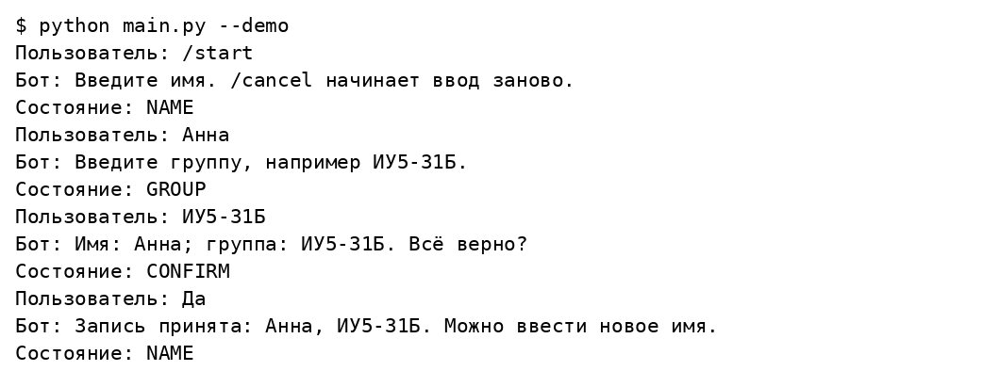
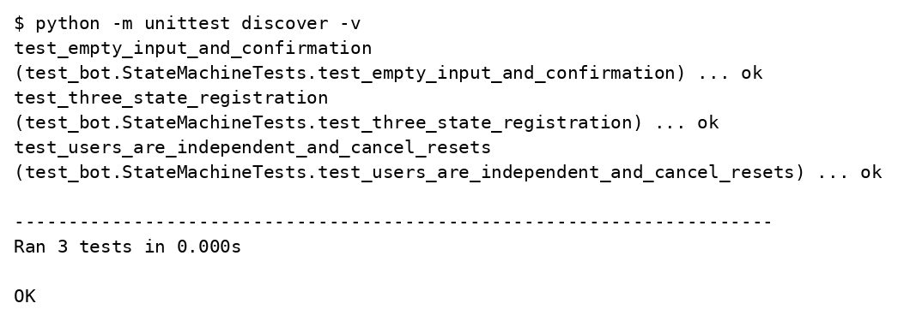

# Лабораторная работа 7

## Telegram бот на основе конечного автомата

Вариант 17

Студент ____________________

Группа ____________________

Преподаватель ____________________

Москва 2026

## Задание

Разработать Telegram бота, реализующего конечный автомат из трёх состояний.

## Решение

Бот собирает имя и группу и предлагает подтвердить данные. Ровно три состояния: NAME, GROUP и CONFIRM. После Да или Нет автомат возвращается в NAME. Команды /start и /cancel очищают текущий ввод. Сессии независимы для пары chat_id и user_id; данные существуют только в памяти процесса.

### labs/07_fsm_bot/bot.py

```python
class RegistrationBot:
    """Три состояния: NAME, GROUP, CONFIRM. Данные хранятся в памяти."""
    NAME, GROUP, CONFIRM = 'NAME', 'GROUP', 'CONFIRM'

    def __init__(self):
        self.sessions = {}

    def reply(self, user, text):
        if text in ('/start', '/cancel') or user not in self.sessions:
            self.sessions[user] = {'state': self.NAME}
            return 'Введите имя. /cancel начинает ввод заново.', {'remove_keyboard': True}

        session = self.sessions[user]
        text = text.strip()
        if session['state'] == self.NAME:
            if not text:
                return 'Имя не должно быть пустым.', None
            session['name'] = text
            session['state'] = self.GROUP
            return 'Введите группу, например ИУ5-31Б.', None

        if session['state'] == self.GROUP:
            if not text:
                return 'Группа не должна быть пустой.', None
            session['group'] = text
            session['state'] = self.CONFIRM
            message = f"Имя: {session['name']}; группа: {text}. Всё верно?"
            return message, {'keyboard': [['Да', 'Нет']], 'resize_keyboard': True}

        if text.casefold() == 'да':
            message = f"Запись принята: {session['name']}, {session['group']}."
            self.sessions[user] = {'state': self.NAME}
            return message + ' Можно ввести новое имя.', {'remove_keyboard': True}
        if text.casefold() == 'нет':
            self.sessions[user] = {'state': self.NAME}
            return 'Введите имя заново.', {'remove_keyboard': True}
        return 'Выберите Да или Нет.', None
```

### labs/07_fsm_bot/main.py

```python
import sys
from bot import RegistrationBot
from telegram_api import run_bot


if __name__ == '__main__':
    bot = RegistrationBot()
    if '--demo' in sys.argv:
        for message in ['/start', 'Анна', 'ИУ5-31Б', 'Да']:
            answer, keyboard = bot.reply(1, message)
            print('Пользователь:', message)
            print('Бот:', answer)
            print('Состояние:', bot.sessions[1]['state'])
    else:
        run_bot(bot.reply)
```

### labs/07_fsm_bot/telegram_api.py

```python
import json
import os
from urllib.request import Request, urlopen
from urllib.error import URLError


def api_call(token, method, payload):
    data = json.dumps(payload).encode('utf-8')
    request = Request(f'https://api.telegram.org/bot{token}/{method}', data=data,
                      headers={'Content-Type': 'application/json'})
    try:
        with urlopen(request, timeout=40) as response:
            answer = json.load(response)
    except (URLError, TimeoutError, ValueError):
        # Не выводим URL ошибки: он содержит секретный токен.
        raise RuntimeError('Не удалось обратиться к Telegram API') from None
    if not answer.get('ok'):
        raise RuntimeError('Telegram API отклонил запрос')
    return answer['result']


def run_bot(reply):
    token = os.environ.get('TELEGRAM_BOT_TOKEN')
    if not token:
        raise SystemExit('Задайте TELEGRAM_BOT_TOKEN или запустите main.py --demo')
    offset = 0
    print('Бот запущен. Для остановки нажмите Ctrl+C.')
    try:
        while True:
            updates = api_call(token, 'getUpdates', {'offset': offset, 'timeout': 30,
                                                   'allowed_updates': ['message']})
            for update in updates:
                message = update.get('message', {})
                if 'text' in message:
                    key = (message['chat']['id'], message['from']['id'])
                    text, keyboard = reply(key, message['text'])
                    payload = {'chat_id': message['chat']['id'], 'text': text}
                    if keyboard:
                        payload['reply_markup'] = keyboard
                    api_call(token, 'sendMessage', payload)
                offset = update['update_id'] + 1
    except KeyboardInterrupt:
        print('Бот остановлен.')
    except RuntimeError as error:
        raise SystemExit(str(error)) from None
```

### labs/07_fsm_bot/test_bot.py

```python
import unittest
from bot import RegistrationBot


class StateMachineTests(unittest.TestCase):
    def setUp(self):
        self.bot = RegistrationBot()
        self.bot.reply(1, '/start')

    def test_three_state_registration(self):
        self.assertEqual(self.bot.sessions[1]['state'], 'NAME')
        self.bot.reply(1, 'Анна')
        self.assertEqual(self.bot.sessions[1]['state'], 'GROUP')
        self.bot.reply(1, 'ИУ5-31Б')
        self.assertEqual(self.bot.sessions[1]['state'], 'CONFIRM')
        self.assertIn('Запись принята', self.bot.reply(1, 'Да')[0])
        self.assertEqual(self.bot.sessions[1]['state'], 'NAME')

    def test_empty_input_and_confirmation(self):
        self.bot.reply(1, ' ')
        self.assertEqual(self.bot.sessions[1]['state'], 'NAME')
        self.bot.reply(1, 'Анна')
        self.bot.reply(1, ' ')
        self.assertEqual(self.bot.sessions[1]['state'], 'GROUP')
        self.bot.reply(1, 'ИУ5-31Б')
        self.bot.reply(1, 'возможно')
        self.assertEqual(self.bot.sessions[1]['state'], 'CONFIRM')
        self.bot.reply(1, 'Нет')
        self.assertEqual(self.bot.sessions[1]['state'], 'NAME')

    def test_users_are_independent_and_cancel_resets(self):
        self.bot.reply(1, 'Анна')
        self.bot.reply(2, '/start')
        self.assertEqual(self.bot.sessions[2]['state'], 'NAME')
        self.assertEqual(self.bot.sessions[1]['state'], 'GROUP')
        self.bot.reply(1, '/cancel')
        self.assertEqual(self.bot.sessions[1], {'state': 'NAME'})
```

## Результаты выполнения





## Проверка результата

Локально пройдена цепочка NAME → GROUP → CONFIRM → NAME. Тесты проверяют пустой ввод, неверное подтверждение, отказ, отмену и независимость пользователей. Токен не предоставлен, поэтому реальная переписка в Telegram не проверялась.

## Источники

https://github.com/ugapanyuk/BKIT_2021/wiki/lab_bot2
